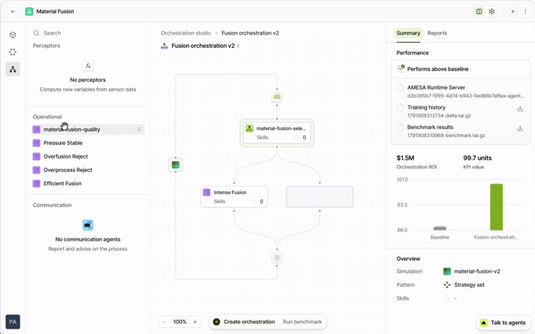
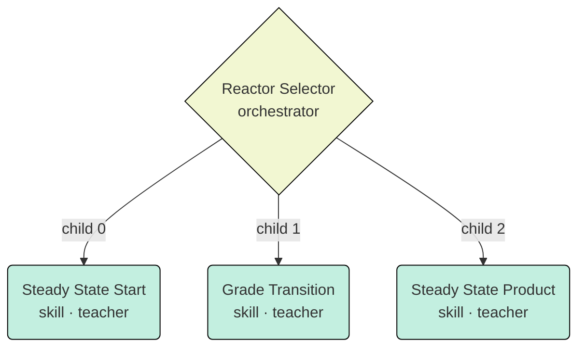
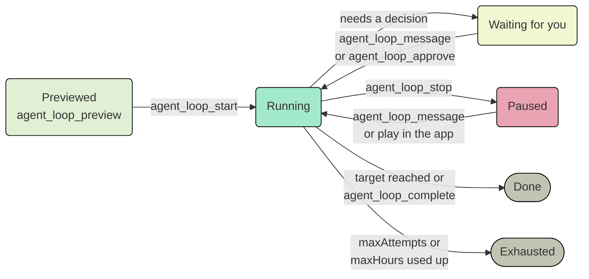

<p align="center">
  <picture>
    <source media="(prefers-color-scheme: dark)" srcset="assets/amesa-wordmark-dark.webp">
    
  </picture>
</p>

<h1 align="center">From Dataset to Autonomous Operational Agents</h1>

<p align="center">
  
</p>

The AMESA MCP server lets an AI assistant such as Claude run the whole AMESA platform for you. It turns plant data into a simulator, builds and trains agents against that simulator, and leaves you with agents that run your process.

This README walks the platform lifecycle stage by stage and lists every tool, with its purpose, under the stage it belongs to. Tool availability depends on your organization's permissions. Use your browser's find (Ctrl+F / Cmd+F) to look up a tool by name or purpose.

**186** tools · **9** lifecycle stages · **6** autonomous loop goals

---

## Contents

| Section | Tools |
| --- | ---: |
| [Before you begin](#before-you-begin) | 9 |
| [1. Set up the use case](#1-set-up-the-use-case) | 12 |
| [2. Prepare the data](#2-prepare-the-data) | 12 |
| [3. Fit a simulator](#3-fit-a-simulator) | 24 |
| [4. Capture domain knowledge](#4-capture-domain-knowledge) | 9 |
| [5. Design the agent system](#5-design-the-agent-system) | 5 |
| [6. Build the components](#6-build-the-components) | 34 |
| [7. Assemble the orchestration](#7-assemble-the-orchestration) | 23 |
| [8. Train and evaluate](#8-train-and-evaluate) | 27 |
| [9. Operate the agents](#9-operate-the-agents) | 15 |
| [Autonomous loops](#autonomous-loops) | 12 |
| [Jobs and diagnostics](#jobs-and-diagnostics) | 4 |
| **Total** | **186** |
| [Repo Structure](#repo-structure) | |

---

## Before you begin

You work with the platform in plain language, and your assistant calls the tools for you. You don't need to call them yourself. Knowing which tools exist helps you ask for the right things and follow what the assistant is doing.

### Connect your assistant

This repo's [`.mcp.json`](.mcp.json) already configures the AMESA MCP server as `amesa`. Open the repo in an MCP client that reads `.mcp.json` (such as Claude Code), and sign in with your AMESA account when the client asks. To use another MCP client, copy the `amesa` entry from `.mcp.json` into that client's configuration.

Every tool acts as you, with your organization's permissions.

### Connect an AMESA Compute Node

Data, simulator and validation jobs run on an AMESA Compute node connected to your organization, and training can also run on AMESA's managed compute. A compute node is a small set of Docker containers that runs on your own machine and registers with the AMESA platform.

#### Prerequisites

- **Linux or macOS.** On Windows, use WSL (Windows Subsystem for Linux) and run every command below inside your WSL shell.
- **Python 3.11** (3.10 is also supported).
- **Docker**, installed and running. The node runs in containers, and `amesa compute connect` stops if the Docker daemon isn't running.
- Ports **8000** (compute service) and **8888** (file storage) free on the machine.
- An AMESA account.

#### Set up the node

1. Install AMESA. The `amesa` Python package includes AMESA Compute and the `amesa` CLI. Install it in a virtual environment:

   ```bash
   python3.11 -m venv .venv
   source .venv/bin/activate
   pip install amesa
   ```

   Check the installation with `amesa version`.

2. Sign in to AMESA:

   ```bash
   amesa login
   ```

   The CLI opens your browser on the AMESA sign-in page. If it doesn't open, copy the URL the CLI prints. Sign in and grant the CLI access within about 60 seconds; if the step times out, run `amesa login` again.

3. Connect the compute node:

   ```bash
   amesa compute connect
   ```

   The CLI checks Docker and the ports, asks you to pick your organization and name the node (default `<os-user>-local`), pulls the node images and starts the node in the background. It then registers the node with the platform. Reconnecting later reuses the same registration.

4. Ask your assistant to run `cluster_list` and `cluster_health_get` to confirm the node is online. From the terminal, `amesa compute status` shows the node, its organization and its jobs.

The node is private to you by default: only you, and assistants acting for you, can see it, run jobs on it or use the datasets staged on it. Add `--public` to `amesa compute connect` to share it with your organization. Every connect applies the setting, so reconnecting without `--public` makes the node private again.

When you're done, `amesa compute disconnect` stops the node. Its registration is kept, so your staged datasets are still there on the next `amesa compute connect`.

> [!TIP]
> **Connecting without a browser login.** Your assistant can issue a single-use enrollment code with `compute_enrollment_issue` (also available as `cluster_create_local`). Run the command it returns, `amesa compute connect --enroll <code>`, on the machine within 15 minutes. This is useful for a remote server where you can't open a browser.

> [!TIP]
> **Finding a tool by intent.** If you're not sure which tool fits a task, the assistant can search the catalog with `mcp_tools_search`, which returns each match's description and arguments, and call one with `mcp_tools_call`. `mcp_tools_read` runs up to eight read-only tools in one round trip. `platform_knowledge_search` and `platform_knowledge_get` return AMESA's curated platform facts and methodology, with citations, on how to approach a problem.

### Tools (9)

| Tool | Purpose |
| --- | --- |
| `mcp_tools_search` | Search the tool catalog by intent; returns names, descriptions and arguments. |
| `mcp_tools_read` | Run up to eight read-only tools in one round trip. |
| `mcp_tools_call` | Call a tool found through the catalog. |
| `platform_knowledge_search` | Search AMESA's curated platform facts and methodology concepts, with citations. |
| `platform_knowledge_get` | Read one platform fact or concept by its ID, with its related items and citations. |
| `cluster_list` | List your organization's compute clusters and whether each is connected. |
| `cluster_health_get` | Check whether a cluster is online and healthy. |
| `cluster_create_local` | Issue a single-use code to enroll a local machine (same as compute_enrollment_issue). |
| `compute_enrollment_issue` | Issue a single-use code that enrolls a new local compute node. |

---

## 1. Set up the use case

*Journey stage: setup*

A *use case*, also called a project, holds everything for one process: its data, simulator, knowledge, agents, scenarios and results. The platform tracks each use case's progress through the stages setup → data → knowledge → training → complete.

| You bring | You end with |
| --- | --- |
| An organization and a process you want to control | A use case with a KPI and a journey stage |

1. Find your organization and use case with `organization_list` and `use_case_list`. Then open it with `use_case_get`, or with `use_case_brief_get` for a short overview. If the use case doesn't exist yet, `use_case_create` creates it *(preview: available on the staging server only)*.
2. Define what success means. `kpi_settings_get` and `kpi_settings_update` read and set the KPI that training is measured against, for example yield, energy per tonne or off-spec time, and the ROI that converts it into money. An update replaces the KPI and ROI settings as a whole; the exploration settings are kept when you leave them out.
3. Track progress with `use_case_journey_get`. When a stage is finished, `use_case_journey_advance` records it. `assistant_handoff` is used by the AMESA app's own assistants: AMESA Brain hands off to the knowledge engineer for the KPI interview, and specialists hand back to AMESA Brain.

### Tools (12)

| Tool | Purpose |
| --- | --- |
| `organization_list` | List the organizations you belong to. |
| `organization_get` | Find an organization's ID by its exact name. |
| `use_case_list` | List use cases (projects). |
| `use_case_create` | Create a use case *(preview: staging server only)*. |
| `use_case_get` | Read a use case in full. |
| `use_case_brief_get` | Read a short overview of a use case. |
| `use_case_update` | Change a use case's name, description or settings. |
| `kpi_settings_get` | Read the KPI and ROI settings training is measured against. |
| `kpi_settings_update` | Set the KPI and ROI settings (replaces them as a whole; exploration settings are kept). |
| `use_case_journey_get` | See which lifecycle stage the use case is in. |
| `use_case_journey_advance` | Record that the use case moved to a new stage. |
| `assistant_handoff` | Hand off between the AMESA app's assistants (the KPI interview, or back to AMESA Brain). |

---

## 2. Prepare the data

*Journey stage: data*

Start from historian exports or other time-series CSV data. Each column is a sensor, which the simulator predicts, or an action, which an agent will set. Clean, focused data produces a simulator that agents can trust.

| You bring | You end with |
| --- | --- |
| A time-series CSV and a connected compute node | A dataset with a data score and clear column roles |

#### Stage the dataset first

Before any data operation in this section, stage your CSV on your connected compute node with the `amesa` CLI you installed in [Connect an AMESA Compute Node](#connect-an-amesa-compute-node). Apart from setting up the node, this is the only CLI command you need before you use the MCP tools: the data, simulator and clustering tools all work on staged datasets.

Run it on the machine where the compute node is running:

```bash
amesa data stage ./reactor.csv --name reactor
```

The CLI uploads the CSV to the node, cleans it and registers it with the platform. Only a pointer and the dataset's schema go to the platform; the data stays on your node. The CLI asks:

1. **Dataset name**, unless you passed `--name`. It defaults to the file name.
2. **Does this CSV have a units row?** Answer Yes if the first data row holds units, such as `,,C,kPa`, rather than measurements.
3. **What is a row?** *Time-series* for moments of one process, or *Configuration-based* for independent samples such as recipes or tests.
4. **Column roles**: sensor, action, replica or datetime. Columns named with an `s_`, `a_` or `r_` prefix are assigned sensor, action or replica automatically, and the prefix is removed from the name: refer to `s_temp` as `temp` in every later tool. At least one column must be a sensor, and training a simulator also needs at least one action. If you pick a datetime column, the rows are sorted by it.

You can change the roles later with `amesa_data_assign`. Staging the same CSV again after it was removed from the node reattaches the original dataset.

#### Work with the staged dataset

1. Find the staged dataset with `dataset_list`, which shows its columns and their current roles, and attach it to the use case with `use_case_dataset_attach` as soon as you choose it. The first dataset attached becomes the use case's primary dataset, which supplies its sensors and actions until a simulator is attached. Every `amesa_data_*` tool also takes an optional `projectId` that attaches the dataset the same way.
2. Profile it. `amesa_data_stats` describes each column, `amesa_data_integrity` scores empty, infinite, non-numeric, outlier and flat values, and `amesa_data_score` scores how strongly the sensors respond to the actions. `amesa_data_rows` shows raw rows in their original order, up to 100 rows and 12 columns at a time, with optional filters, so you can check values directly.
3. Correct the column roles with `amesa_data_assign`. A column can be a sensor, a replica (a sensor replayed from the data), an action or ignored, and perceptor output columns can be switched on (`perceived`) or off. It can also set or clear the datetime column. The tool reports the changes first and saves them only when you approve.
4. Focus the data. `amesa_data_suggest` ranks columns by how much they respond to the actions and proposes which to drop. `amesa_data_prune` drops the episodes (or, for configuration-based data, the rows) with the most outliers, up to the share you let it remove. `amesa_data_split` marks where one run (episode) ends and the next begins, using rules you write or one it suggests. Each of these only reports by default. It writes a new dataset when you apply it and never changes your source data; applying a split again replaces the same split dataset.
5. Add derived signals. `amesa_data_perceive` runs one of the use case's perceptors over the dataset and writes its outputs into a new dataset, as columns named after each perceptor output. The data score, stats and integrity checks then include them.
6. When the KPI has no known benchmark, `amesa_data_kpi` derives one from a column of the data, measured the way a trained agent is judged, and recommends the value, unit and lens to save as the KPI.

```text
# Example request
"Score the reactor dataset, suggest which sensors to keep, and apply
 the suggestion as a new dataset called reactor-focused."

# The assistant calls
amesa_data_score → amesa_data_suggest (suggest) → amesa_data_suggest (apply)
```

### Tools (12)

| Tool | Purpose |
| --- | --- |
| `dataset_list` | List staged datasets with their columns and roles. |
| `use_case_dataset_attach` | Attach a staged dataset to the use case; the first one becomes its primary dataset. |
| `amesa_data_stats` | Describe each column of a dataset. |
| `amesa_data_rows` | Read raw rows of a staged dataset, with optional filters (read-only). |
| `amesa_data_integrity` | Score empty, infinite, non-numeric, outlier and flat values. |
| `amesa_data_score` | Score how strongly the sensors respond to the actions. |
| `amesa_data_assign` | Set columns as sensor, replica, action, ignored or perceived, and set the datetime column. |
| `amesa_data_suggest` | Rank columns by how much they respond and propose a focused set. |
| `amesa_data_prune` | Drop the episodes or rows with the most outliers into a new copy of the dataset. |
| `amesa_data_split` | Suggest or apply episode-boundary rules and write the split dataset. |
| `amesa_data_perceive` | Run a perceptor over a dataset and write its outputs as new columns in a new dataset. |
| `amesa_data_kpi` | Derive a KPI benchmark from a data column and recommend the KPI. |

---

## 3. Fit a simulator

*Journey stage: data*

Agents learn by practicing on a simulator, never on the live plant. AMESA trains a data-driven model (DDM) of your process from the prepared dataset. If you already have a first-principles simulator, you can publish it instead.

| You bring | You end with |
| --- | --- |
| A prepared dataset, or your own simulator code | A scored simulator with mapped sensors and actions, and operating clusters |

1. Train the model with `amesa_sim_train`, then check it with `amesa_sim_analyze`, which rolls it out over episodes of the dataset it was trained on and reports the error for each sensor. The platform scores each analysis. Read the score with `simulator_score_get` and a validation run with `simulator_validation_get`. `simulator_variable_fidelity_get` gives one variable's result, and `simulator_relationship_get` how one action relates to one sensor.
2. To bring your own simulator, publish it with `sim_publish_metadata`, upload the code with `sim_publish_code`, confirm with `sim_confirm_upload`, then check it with `amesa_sim_validate`.
3. Review how variables are mapped with `mapping_list`. Rename a variable with `mapping_update`; `mapping_dependents_list` shows what still uses a name, and a rename is refused while anything does.
4. Find the operating regimes in your data with `amesa_cluster_create`, then turn them into scenario definitions with `amesa_cluster_convert` and publish them into the use case with `clustering_scenarios_publish`. `amesa_cluster_sims` trains one simulator per cluster when the regimes behave too differently for a single model. These clusters are also what `orchestration_baseline_create` builds a first orchestration from (see [7. Assemble the orchestration](#7-assemble-the-orchestration)).
5. Attach the simulator to the use case with `use_case_simulator_assign` and check its sensors and actions with `use_case_sensors_get`. Assigning adds simulators to the use case; the first one becomes the primary simulator. To make a different trained simulator the primary, for example a corrected one after a role change, use `use_case_simulator_replace`. It asks before dropping any variable the use case still uses, and `dryRun` previews the change.

> [!NOTE]
> **Mappings come from the simulator build.** Only a variable's mapped name can change. To make a column a sensor, an action or ignored, change the dataset's roles with `amesa_data_assign` and train a new build.

### Tools (24)

| Tool | Purpose |
| --- | --- |
| `amesa_sim_train` | Train a data-driven simulator from a dataset. |
| `amesa_sim_analyze` | Roll a trained simulator out over its dataset's episodes; the platform scores it. |
| `amesa_sim_validate` | Validate a code simulator you published (not a data-driven one). |
| `simulator_list` | List simulators and their latest builds. |
| `simulator_retrieve` | Get a simulator build's image reference and whether it is ready. |
| `simulator_score_get` | Read a simulator's score. |
| `simulator_validation_get` | Read one simulator validation run. |
| `simulator_variable_fidelity_get` | Read one variable's result from a validation run. |
| `simulator_relationship_get` | Read how one action relates to one sensor in a validation run (not causal). |
| `simulator_job_list` | List simulator, data and clustering jobs. |
| `simulator_job_status` | Poll a running simulator job. |
| `sim_publish_metadata` | Register your own simulator. |
| `sim_publish_code` | Get the upload URL for your simulator's code. |
| `sim_confirm_upload` | Confirm a simulator code upload and start its build. |
| `mapping_list` | List a simulator build's sensor and action mappings. |
| `mapping_update` | Rename variables (only the mapped name can change). |
| `mapping_dependents_list` | See what still uses a variable's name. |
| `amesa_cluster_create` | Find operating regimes in a dataset. |
| `amesa_cluster_convert` | Turn found regimes into scenario definitions. |
| `amesa_cluster_sims` | Train one simulator per regime. |
| `activity_cluster_get` | Read the regimes of a variant simulator. |
| `use_case_simulator_assign` | Attach one or more simulators to the use case. |
| `use_case_simulator_replace` | Make another trained simulator the use case's primary simulator. |
| `use_case_sensors_get` | List the use case's sensors and actions. |

---

## 4. Capture domain knowledge

*Journey stage: knowledge*

Good agents are built on how your experts run the process: operating modes, limits, the tasks operators perform and what each task is for. AMESA keeps this as a *domain graph* for each use case. The graph is built from your documents and checked against the platform's objects.

| You bring | You end with |
| --- | --- |
| Operating procedures, P&IDs, control narratives, expert notes | A domain graph of equipment, variables, modes, constraints, tasks and KPIs |

1. Upload documents with `use_case_document_upload`, then read them into the knowledge base with `use_case_document_ingest`. `use_case_document_list` and `use_case_document_delete` manage the set.
2. Search what the use case knows with `use_case_search`: its documents and knowledge, and past conversations if you ask. Every result cites its source.
3. Explore the graph with `use_case_graph_get` and `use_case_graph_query`. The graph holds components, variables, KPIs, constraints, disturbances, operating modes, tasks and actors, and the links between them.
4. Correct or extend it with `use_case_graph_edit`. You can add facts such as a temperature limit, merge duplicates and record decisions. Each change keeps its source, so you can see which document or conversation a fact came from. `use_case_graph_review` confirms or retracts proposed items and settles contradictions.

> [!TIP]
> **Your own words count as evidence.** When you state a fact in conversation, such as "the jacket outlet must stay below 350 K", the assistant can record it as confirmed with you as the source. Facts the assistant infers from documents stay proposed until you or the evidence confirm them.

### Tools (9)

| Tool | Purpose |
| --- | --- |
| `use_case_document_upload` | Upload a reference document. |
| `use_case_document_ingest` | Read a document into the knowledge base. |
| `use_case_document_list` | List the use case's documents. |
| `use_case_document_delete` | Remove a document. |
| `use_case_search` | Search the use case's documents, knowledge and past conversations, with citations. |
| `use_case_graph_get` | Read the domain graph, an entity's neighborhood, or its gaps. |
| `use_case_graph_query` | Ask targeted questions of the domain graph. |
| `use_case_graph_edit` | Add, link, merge or correct entities and facts. |
| `use_case_graph_review` | Confirm or retract proposed items and settle contradictions. |

---

## 5. Design the agent system

*Journey stage: knowledge*

AMESA agents are modular. Each *skill* handles one task, and an *orchestrator* decides which skill acts at each moment. This is how experienced operators divide their work. Before writing any code, you draft that structure as a *decomposition*.

| You bring | You end with |
| --- | --- |
| The tasks and modes in the domain graph | An approved decomposition, promoted into real components and an orchestration |

1. Draft the tree with `decomposition_create`. It has one root orchestrator, which holds skills, skill groups (a planner skill followed by an executor skill) or other orchestrators. Each node can name the domain-graph tasks it handles and whether it is learned (a teacher) or programmed (a controller).
2. Refine it with `decomposition_edit` and review it with `decomposition_get`. Unfinished parts are saved and reported as warnings, so you can iterate. `decomposition_delete` removes a decomposition you no longer want, with its whole history; it can't be undone, and a promoted decomposition can't be deleted while its orchestration exists.
3. Once you approve it, `decomposition_promote` creates a placeholder for every skill and orchestrator, plus an orchestration wired the way the tree is drawn. The decomposition must have no warnings left. Promoting creates real components, so it needs your approval: asking for those components counts as approval.

A typical reactor decomposition:



### Tools (5)

| Tool | Purpose |
| --- | --- |
| `decomposition_create` | Draft the tree of orchestrators and skills. |
| `decomposition_edit` | Refine a draft decomposition. |
| `decomposition_get` | Read a decomposition and its warnings. |
| `decomposition_promote` | Create real components and an orchestration from an approved draft. |
| `decomposition_delete` | Delete a decomposition and its history (can't be undone). |

---

## 6. Build the components

*Journey stage: knowledge*

Components are small Python packages that you publish as versions. Each new version is validated on your compute node before it can be trained. The assistant can write the code, or you can bring your own.

| Component | What it does | Tools |
| --- | --- | --- |
| **Perceptor** | Computes a derived signal from raw sensors, for example a tracking error or a running yield, so that skills and goals can use it. | `perceptor_create`, `perceptor_implementation_publish`, `perceptor_confirm_upload`, `amesa_perceptor_validate` |
| **Skill** (teacher) | A skill learned through reinforcement learning. It defines the actions it may take, the sensors it sees, and its reward, success and termination conditions. | `operational_agent_create`, `operational_agent_implementation_publish`, `operational_agent_confirm_upload`, `amesa_agent_validate`; or `operational_agent_create_template` for a teacher driven by guidance alone |
| **Skill** (controller) | A programmed skill, such as PID logic, an existing control strategy or a safety interlock. | Same as a teacher, with type `controller` |
| **Coach** | Coordinates skills that share a goal. | `operational_agent_create` with type `coach` |
| **Orchestrator** | Picks which skill acts at each step. It can be learned or programmed. | `orchestrator_create`, `orchestrator_implementation_publish`, `orchestrator_confirm_upload`, `amesa_orchestrator_validate` |

1. Start from a scaffold. `get_artifact_scaffold` returns a correct project layout for any component type.
2. Or start from the blank teacher. `operational_agent_create_template` creates an agent from the blank teacher template, published as its first version with no upload, code review, approval or validation needed. The template is a pass-through teacher: it uses the simulator's reward, never declares success or termination, and sees every sensor, so its goals and success criteria come from guidance set in the app or published with the guidance tools. It takes an optional name (default "Blank Teacher") and an optional `realizes`, the domain-graph entity it fills.
3. Publish. Each `*_create` or `*_implementation_publish` call returns a short-lived upload URL. Pass a `requestId` (a UUID of your choice) on every create, publish and update call, so a retry doesn't create a duplicate. The assistant uploads the packaged code there and confirms with the matching `*_confirm_upload`. Code the assistant wrote itself can go in one call instead: `submit_code_file` packages the files as a new version.
4. Validate. Run the matching `amesa_*_validate`, then follow it with `component_validation_status`. Every validation runs the plugin checks (structure, pyproject type, imports). A skill's validation also runs it against a mock of your simulator's sensors and actions.
5. Inspect any published version's code with `component_source_get`.

### Guidance: goals without code

*Guidance* lets you state what a skill should achieve without writing a reward function. You can say "Maximize episode yield" or "Minimize concentration error", and use perceptor outputs as variables. Guidance items live in a library for each use case.

1. Create items with `guidance_create` (goals, constraints, success criteria or rewards). Review them with `guidance_list` and `guidance_get`, and change them with `guidance_update`.
2. Attach an item to a skill with `guidance_publish_to_agent`. `guidance_agent_get` reads the clauses on a skill version, and `guidance_remove_from_agent` removes clauses, for example once the skill's code takes over that hook. Both changes publish a new version and leave the old one as it is.

> [!IMPORTANT]
> **Guidance overrides the code's hooks.** Only teachers take guidance; a controller is refused. A teacher with code takes it too: in training, reward clauses (Minimize, Maximize, Maintain, Approach, Avoid) replace `compute_reward`, Succeed replaces `compute_success_criteria` and Terminate replaces `compute_termination`. Hooks without guidance keep using the code.

### Tools (34)

| Tool | Purpose |
| --- | --- |
| `submit_code_file` | Publish files the assistant wrote as a new version of a skill, perceptor or orchestrator. |
| `get_artifact_scaffold` | Get the runtime contract and a minimal example for a component type. |
| `perceptor_list` | List perceptors. |
| `perceptor_get` | Read a perceptor and its versions. |
| `perceptor_create` | Create a perceptor and its first version. |
| `perceptor_update` | Rename or describe a perceptor. |
| `perceptor_implementation_publish` | Publish a new perceptor version. |
| `perceptor_confirm_upload` | Confirm a perceptor code upload. |
| `amesa_perceptor_validate` | Validate a perceptor version. |
| `operational_agent_list` | List skills (teachers, controllers, coaches). |
| `operational_agent_get` | Read a skill and its versions. |
| `operational_agent_retrieve` | Get every file of one skill version. |
| `operational_agent_create` | Create a skill and its first version. |
| `operational_agent_create_template` | Create a teacher from the blank template; no upload, review, approval or validation needed. |
| `operational_agent_update` | Rename or describe a skill. |
| `operational_agent_implementation_publish` | Publish a new skill version. |
| `operational_agent_confirm_upload` | Confirm a skill code upload. |
| `amesa_agent_validate` | Validate a skill version, including a run against a mock simulator. |
| `orchestrator_list` | List orchestrators. |
| `orchestrator_get` | Read an orchestrator and its versions. |
| `orchestrator_create` | Create an orchestrator and its first version. |
| `orchestrator_update` | Rename or describe an orchestrator. |
| `orchestrator_implementation_publish` | Publish a new orchestrator version. |
| `orchestrator_confirm_upload` | Confirm an orchestrator code upload. |
| `amesa_orchestrator_validate` | Validate an orchestrator version. |
| `component_validation_status` | Follow a validation run started by an amesa_*_validate tool. |
| `component_source_get` | Read the code of a published version. |
| `guidance_list` | List guidance items in the library. |
| `guidance_get` | Read one guidance item. |
| `guidance_create` | Create a goal, constraint, success criterion or reward. |
| `guidance_update` | Change a guidance item. |
| `guidance_publish_to_agent` | Publish guidance to a teacher as a new version. |
| `guidance_agent_get` | Read the guidance clauses on a skill version. |
| `guidance_remove_from_agent` | Remove guidance clauses from a skill in a new version. |

---

## 7. Assemble the orchestration

*Journey stage: knowledge → training*

An *orchestration* is the deployable agent system. It combines perceptors, orchestrators and skills in a workflow, and it uses *scenarios* to define the conditions each part trains under.

| You bring | You end with |
| --- | --- |
| Validated components and operating regimes | An orchestration ready for training |

1. Define scenarios: starting states, setpoint changes and disturbances. Write them with `scenario_create` and `scenario_update`, or publish the regimes found in your data with `clustering_scenarios_publish`. Connect them into a flow with `scenario_flow_member_add`, `scenario_flow_edge_create` or `scenario_flow_graph_import`.
2. Create the orchestration. The quickest start is `orchestration_baseline_create`, which builds a best-practice baseline from the use case's activity clusters: one teacher per cluster, each practicing its own cluster's scenario, under one orchestrator, all aiming at the KPI. A clustering of phases in time becomes a fixed sequence of skills; a clustering of operating regions lets the orchestrator pick any skill at each step. It needs existing clusters, an established KPI and mapped sensors and actions. Otherwise, create one with `orchestration_create`, copy an existing one with `orchestration_duplicate`, or reuse the one that `decomposition_promote` already built.
3. Wire it. `orchestration_workflow_deploy` replaces the whole workflow in one step: root orchestrators, their skills, the perceptors and the scenarios assigned to each. `orchestration_component` changes one part. Read the result back with `orchestration_get_workflow`. Reusable shapes built from published components are saved as *orchestration patterns*: `orchestration_pattern_create`, `orchestration_pattern_list`, `orchestration_pattern_get`, `orchestration_pattern_update`, and `orchestration_pattern_apply` to attach a pattern beneath an orchestrator.
4. Run `orchestration_prepare_for_training`, which repairs scenario selections that no longer match the use case's scenarios. It doesn't start training.

### Tools (23)

| Tool | Purpose |
| --- | --- |
| `scenario_list` | List scenarios. |
| `scenario_get` | Read one scenario. |
| `scenario_create` | Define a training scenario. |
| `scenario_update` | Change a scenario. |
| `scenario_flow_get` | Read the scenario flow graph. |
| `scenario_flow_member_add` | Add a scenario to the flow. |
| `scenario_flow_member_remove` | Remove a scenario from the flow. |
| `scenario_flow_edge_create` | Connect two scenarios in the flow. |
| `scenario_flow_graph_import` | Import a whole scenario flow at once. |
| `clustering_scenarios_publish` | Publish regime-based scenarios into the use case. |
| `orchestration_list` | List orchestrations. |
| `orchestration_baseline_create` | Build a first orchestration from the activity clusters: one teacher per cluster under one orchestrator. |
| `orchestration_create` | Create an orchestration. |
| `orchestration_duplicate` | Copy an orchestration exactly. |
| `orchestration_component` | Add or remove one component. |
| `orchestration_workflow_deploy` | Replace the whole workflow in one step. |
| `orchestration_get_workflow` | Read the current workflow. |
| `orchestration_prepare_for_training` | Repair invalid scenario selections before training. |
| `orchestration_pattern_create` | Save a reusable orchestration shape built from published components. |
| `orchestration_pattern_list` | List saved patterns. |
| `orchestration_pattern_get` | Read one pattern. |
| `orchestration_pattern_update` | Change a pattern. |
| `orchestration_pattern_apply` | Attach a pattern beneath an orchestrator in an orchestration. |

---

## 8. Train and evaluate

*Journey stage: training*

Training runs on your compute cluster. Every finished training session is benchmarked against the use case's KPI and against baseline control, so you can see how much better the agents perform.

| You bring | You end with |
| --- | --- |
| A prepared orchestration and an online cluster | Trained agents with benchmark evidence against your KPI |

1. Check capacity with `training_capacity_probe` and get the suggested cycles for each part of the orchestration with `training_cycle_allocation_get`. `training_job_submission_get` dry-runs the submission so you can check it, then start the run with `training_job_submit`. `training_job_stop` stops it, and `training_job_restart` starts a failed run again with exactly the parameters it was submitted with.
2. Watch progress with `training_session_list`, `training_session_get` and `training_job_logs_get`.
3. Evaluate. Each run ends with a benchmark. `benchmark_summary` gives its episode, step and reward summary, and `report_get` the KPI result from the run's generated report. `benchmark_compare` compares two runs' benchmarks scenario by scenario. `benchmark_describe` and `benchmark_query` let you query every benchmark step in SQL, and `benchmark_episode_trace` pages through episode rewards.
4. Look at the history. `historian_query` returns the time series recorded during a run, and `training_history_get` returns the training curve.
5. Share the results. The platform generates training, benchmark, historian and simulator reports by itself; `report_generate` makes sure one exists and reports its status. Once a training report is generated, `training_skill_result_get` reads one skill's result from it: criterion evidence, reward points and quality limits. `report_generate` also writes a skill report on request: `skill_report_candidates` lists the scenario and skill pairs from completed training that such a report can cover. `report_create` saves a report the assistant wrote.

### Tools (27)

| Tool | Purpose |
| --- | --- |
| `training_capacity_probe` | Check whether the cluster can take a training run. |
| `training_cycle_allocation_get` | Get the suggested training cycles for each agent. |
| `training_job_submit` | Start a training run. |
| `training_job_stop` | Stop a training run. |
| `training_job_restart` | Start a failed run again with the same parameters. |
| `training_job_submission_get` | Dry-run a training submission without starting it. |
| `training_job_logs_get` | Read a run's logs. |
| `training_session_list` | List training sessions. |
| `training_session_get` | Read a session's progress and results. |
| `training_skill_result_get` | Read one skill's generated training result. |
| `training_history_get` | Read the training curve. |
| `training_history_upload` | Upload training history recorded elsewhere. |
| `benchmark_list` | List benchmarks. |
| `benchmark_summary` | Read a benchmark's episode, step and reward summary. |
| `benchmark_describe` | Describe what a benchmark contains. |
| `benchmark_query` | Query benchmark data in depth. |
| `benchmark_compare` | Compare two training runs' benchmarks per scenario. |
| `benchmark_episode_trace` | Page through a benchmark's episode rewards. |
| `benchmark_artifact_list` | List a training run's artifacts (IDs and times only). |
| `benchmark_report_skill_get` | Read one skill and scenario result from a benchmark report. |
| `historian_describe` | List the columns of a run's recorded time series. |
| `historian_query` | Query recorded time series. |
| `report_create` | Save a report the assistant wrote. |
| `report_generate` | Make sure a generated report exists and read its status, or write a skill report on request. |
| `report_list` | List reports. |
| `report_get` | Read a report. |
| `skill_report_candidates` | List scenario and skill pairs from completed training that a skill report can cover. |

---

## 9. Operate the agents

*Journey stage: complete*

A trained orchestration becomes a set of operational agents. Two more agent types help people work alongside them. *Communication agents* explain what the system is doing in plain language. *Policy agents* apply your site's operating rules.

### Communication agents

Give operators and engineers a conversational view of the agent system, grounded in your documents. Create one, add reference documents, then publish it.

`communication_agent_create` · `communication_agent_document_upload` · `communication_agent_document_ingest` · `communication_agent_publish` · `communication_agent_list` · `communication_agent_get` · `communication_agent_update` · `communication_agent_document_list`

### Policy agents

Encode site rules and procedures from your policy documents and attach them to orchestrators in the workflow, so agent decisions stay inside them.

`policy_agent_create` · `policy_agent_document_upload` · `policy_agent_document_search` · `policy_agent_list` · `policy_agent_get` · `policy_agent_update` · `policy_agent_document_list`

Mark the use case complete with `use_case_journey_advance` once an orchestration beats its baseline.

### Tools (15)

| Tool | Purpose |
| --- | --- |
| `communication_agent_create` | Create a communication agent. |
| `communication_agent_get` | Read a communication agent. |
| `communication_agent_list` | List communication agents. |
| `communication_agent_update` | Change a communication agent. |
| `communication_agent_publish` | Publish a communication agent's name and prompt as a new version. |
| `communication_agent_document_upload` | Upload a reference document. |
| `communication_agent_document_ingest` | Read a document into the agent's knowledge. |
| `communication_agent_document_list` | List the agent's documents. |
| `policy_agent_create` | Create a policy agent. |
| `policy_agent_get` | Read a policy agent. |
| `policy_agent_list` | List policy agents. |
| `policy_agent_update` | Change a policy agent. |
| `policy_agent_document_upload` | Upload a policy document (PDF). |
| `policy_agent_document_list` | List a policy agent's documents. |
| `policy_agent_document_search` | Search a policy agent's documents. |

---

## Autonomous loops

*Reference: background work*

Some stages take many cycles of trying something, checking the result and adjusting. An *agent loop* hands that cycle to the platform. It runs in the background until it reaches a target you set, and it asks you when it needs a decision. Each loop opens its own conversation in the AMESA app, where you can follow it, steer it or pause it.

| Goal | Runs until | Stage |
| --- | --- | :---: |
| `data-score` | The dataset's data score reaches your threshold. The loop prepares episodes, selects column roles and engineers useful features to get there. | [2](#2-prepare-the-data) |
| `simulator-fit` | A candidate simulator's score, and optionally the error of each variable, meets your target. | [3](#3-fit-a-simulator) |
| `agent-fix` | Every skill, orchestrator and perceptor in scope passes validation. The loop publishes fixed versions as it goes. | [6](#6-build-the-components) |
| `training-kpi` | A trained copy of the orchestration beats the KPI target and every enabled scenario baseline. Your original orchestration is never modified. | [8](#8-train-and-evaluate) |
| `training-diagnostics` | Every orchestration of the use case runs a short diagnostic job, after the failures are fixed. Started by `monitor`. | [8](#8-train-and-evaluate) |
| `training-recovery` | A failed training job is assessed, fixed and restarted. The platform starts this one when a job fails; you can't start it yourself. | [8](#8-train-and-evaluate) |



1. Preview the loop with `agent_loop_preview`, then start it with `agent_loop_start`. In review mode the assistant shows you the preview and waits for your approval before starting. When a `training-kpi` loop's only problem is an incomplete KPI, `agent_loop_kpi_interview` asks you the KPI questions in the conversation and starts the loop once you confirm.
2. Follow it with `agent_loop_list` and `agent_loop_get`. When the loop is waiting for you, answer with `agent_loop_message` or approve its proposal with `agent_loop_approve`. `agent_loop_stop` pauses it. New chat messages leave it paused: it resumes only when you ask the assistant to continue it (`agent_loop_message`) or press play in the AMESA app. Training jobs it already started keep running unless you stop them separately. A loop given a `maxAttempts` or `maxHours` limit ends as *exhausted* when the limit runs out without meeting the target. `agent_loop_complete` ends a data, simulator or training loop for good and keeps its current result as final. A training loop first lets its running session finish.

### Whole plans and health checks

Two tools hand larger pieces of work to the platform's own assistants. Each opens a conversation in the AMESA app where you can follow and steer it.

- **AMESA Brain.** `brain` hands a whole multi-step plan to AMESA Brain. Steps run in order, each step's specialists run in parallel, and each step is its own loop. Submitting the plan approves it, and it starts at once.
- **AMESA Monitor.** `monitor` checks that a use case's orchestrations run. It starts short diagnostic jobs with `training_diagnostic_batch_start`, has failures fixed by validate-fix loops, re-runs what was fixed and reports back.

### Tools (12)

| Tool | Purpose |
| --- | --- |
| `agent_loop_preview` | Preview what a loop will do before it starts. |
| `agent_loop_start` | Start a background loop toward a goal. |
| `agent_loop_list` | List loops. |
| `agent_loop_get` | Follow a loop's progress. |
| `agent_loop_message` | Answer, steer or resume a loop. |
| `agent_loop_approve` | Approve or reject a change a loop proposed. |
| `agent_loop_stop` | Pause a loop; it resumes only when explicitly continued. |
| `agent_loop_complete` | End a data, simulator or training loop and keep its result. |
| `agent_loop_kpi_interview` | Ask for a missing KPI, then start the training loop. |
| `brain` | Hand a whole multi-step plan to AMESA Brain. |
| `monitor` | Have the AMESA Monitor check that orchestrations run. |
| `training_diagnostic_batch_start` | Start short diagnostic jobs on several orchestrations (Monitor only). |

---

## Jobs and diagnostics

*Reference: troubleshooting*

Data, simulator and clustering tools start *simulator jobs*, and training starts *training jobs*. They are tracked separately.

- **Simulator jobs.** When a response includes `next`, the job is still running. Poll each job ID it lists with `simulator_job_status`. `simulator_job_list` lists past jobs.
- **When something fails.** `job_diagnostics_get` explains what went wrong, `job_container_logs_get` returns raw logs, and `job_speed_analyze` finds what is slowing a run. `known_issue_match` checks an error against known platform issues and their fixes.

> [!WARNING]
> **A job that never starts.** Jobs wait in the queue when the cluster they target is offline. Check `cluster_health_get`, and pass the ID of an online cluster when you start the job.

### Tools (4)

| Tool | Purpose |
| --- | --- |
| `job_diagnostics_get` | Explain why a training job failed or struggles. |
| `job_container_logs_get` | Read one container's logs for a training job. |
| `job_speed_analyze` | Find what is slowing a job. |
| `known_issue_match` | Match an error against known issues and fixes. |

---

## Repo Structure

```
amesa-agents/
├── AGENTS.md                 # AI agent guidelines (read this if you're an AI agent)
├── README.md                 # This file
├── .mcp.json                 # AMESA MCP server config
├── assets/                   # Images used in the README
├── agent-context/            # Component specs for AI agents to read before implementing
│   ├── teacher/              #   AgentTeacher reference, publishing, and quirks
│   ├── controller/           #   AgentController reference, publishing, and quirks
│   ├── orchestrators/        #   Orchestrator specs (AgentTeacher / AgentController subclasses)
│   ├── perceptors/           #   PerceptorImpl specs
│   ├── goals/                #   Goal types (MaximizeGoal, ApproachGoal, AvoidGoal, CoordinatedGoal) and AgentCoach
│   └── analysis/             #   Benchmark JSON and historian data formats
├── agents/                   # Your implemented agent artifacts
│   ├── controllers/
│   │   ├── creating-and-publishing-controllers.md
│   │   └── controller-example/
│   ├── orchestrators/
│   │   ├── creating-and-publishing-orchestrators.md
│   │   └── orchestrator-example/
│   └── teachers/
│       ├── creating-and-publishing-teachers.md
│       ├── teacher-example/
│       ├── coordinated-example/
│       └── goals-example/
├── datasets/                 # Sample CSV datasets (concrete, fusion, mixer) to stage with `amesa data stage`
├── perceptors/               # Your implemented perceptor artifacts
│   ├── creating-and-publishing-perceptors.md
│   └── perceptors-example/
└── sims/                     # Simulators: demo_sim, polymer_chemistry, polymer_production
```


For guidance on writing components in this repo, see [`AGENTS.md`](./AGENTS.md) and [`agent-context/`](./agent-context/).
