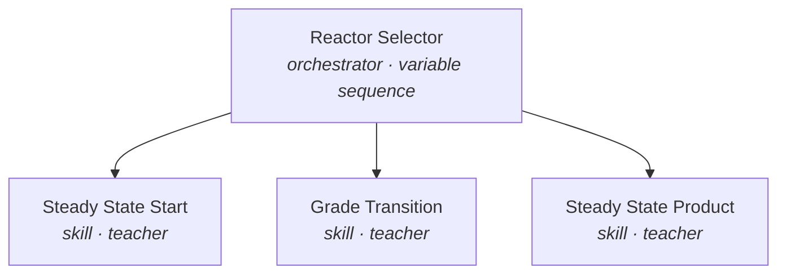
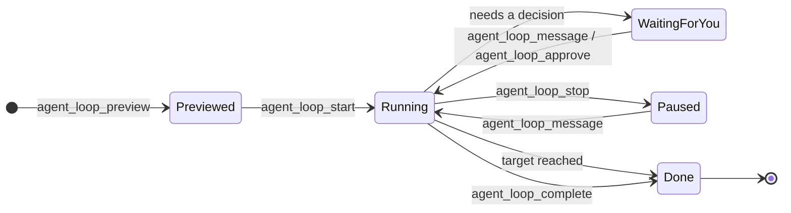

# AMESA MCP Tools: From a Dataset to Autonomous Operational Agents

The AMESA MCP server lets an AI assistant such as Claude run the whole AMESA platform for you. It turns plant data into a simulator, builds and trains agents against that simulator, and leaves you with agents that run your process.

This README walks the lifecycle stage by stage and names the tools used at each step. The full list of tools is in the **[tool index](doc/tools.md)**.

**181** tools · **9** lifecycle stages · **7** autonomous loop goals

```mermaid
flowchart LR
    S1["1 · Set up<br/><i>use case</i>"] --> S2["2 · Prepare data<br/><i>scored dataset</i>"]
    S2 --> S3["3 · Fit simulator<br/><i>validated DDM</i>"]
    S3 --> S4["4 · Capture knowledge<br/><i>domain graph</i>"]
    S4 --> S5["5 · Design agents<br/><i>decomposition</i>"]
    S5 --> S6["6 · Build components<br/><i>skills, perceptors</i>"]
    S6 --> S7["7 · Assemble<br/><i>orchestration</i>"]
    S7 --> S8["8 · Train and evaluate<br/><i>trained agents</i>"]
    S8 --> S9["9 · Operate<br/><i>agents in service</i>"]
```



---

## Table of Contents

- [Before you begin](#before-you-begin)
- **Lifecycle**
  1. [Set up the use case](#1-set-up-the-use-case)
  2. [Prepare the data](#2-prepare-the-data)
  3. [Fit a simulator](#3-fit-a-simulator)
  4. [Capture domain knowledge](#4-capture-domain-knowledge)
  5. [Design the agent system](#5-design-the-agent-system)
  6. [Build the components](#6-build-the-components)
  7. [Assemble the orchestration](#7-assemble-the-orchestration)
  8. [Train and evaluate](#8-train-and-evaluate)
  9. [Operate the agents](#9-operate-the-agents)
- **Reference**
  - [Autonomous loops](#autonomous-loops)
  - [Jobs and diagnostics](#jobs-and-diagnostics)
  - [Tool index](doc/tools.md)
- [Repo Structure](#repo-structure)

---

## Before you begin

You work with the platform in plain language, and your assistant calls the tools for you. You don't need to call them yourself. Knowing which tools exist helps you ask for the right things and follow what the assistant is doing.

### Connect your assistant

This repo's [`.mcp.json`](.mcp.json) already configures the AMESA MCP server as `amesa`. Open the repo in an MCP client that reads `.mcp.json` (such as Claude Code), and sign in with your AMESA account when the client asks. To use another MCP client, copy the `amesa` entry from `.mcp.json` into that client's configuration.

Every tool acts as you, with your organization's permissions.

### Have a compute node online

Data, simulator and validation jobs run on a compute node connected to your organization, and training can also run on AMESA's managed compute. Before you start, ask your assistant to run `cluster_list` and `cluster_health_get` to confirm a node is connected.

To add a machine of your own, `compute_enrollment_issue` (also available as `cluster_create_local`) issues a single-use enrollment code: run the command it returns on that machine within 15 minutes. The node is private to you unless you share it with your organization.

> [!TIP]
> **Finding a tool by intent.** If you're not sure which tool fits a task, the assistant can search the catalog with `mcp_tools_search`, which returns each match's description and arguments, and call one with `mcp_tools_call`. `mcp_tools_read` runs up to eight read-only tools in one round trip. `platform_methodology_search` and `platform_methodology_fetch` return AMESA's own guidance on how to approach a problem.

---

## 1. Set up the use case

*Journey stage: setup*

A *use case*, also called a project, holds everything for one process: its data, simulator, knowledge, agents, scenarios and results. The platform tracks each use case's progress through the stages setup → data → knowledge → training → complete.

| You bring | You end with |
| --- | --- |
| An organization and a process you want to control | A use case with a KPI and a journey stage |

1. Find your organization and use case with `organization_list` and `use_case_list`. Then open it with `use_case_get`, or with `use_case_brief_get` for a short overview.
2. Define what success means. `kpi_settings_get` and `kpi_settings_update` read and set the KPI that training is measured against, for example yield, energy per tonne or off-spec time, and the ROI that converts it into money. An update replaces the saved settings as a whole.
3. Track progress with `use_case_journey_get`. When a stage is finished, `use_case_journey_advance` records it. `assistant_handoff` hands the conversation to the platform assistant that leads the next stage.

<details>
<summary>Tools in this stage (11)</summary>

`organization_list` · `organization_get` · `use_case_list` · `use_case_get` · `use_case_brief_get` · `use_case_update` · `kpi_settings_get` · `kpi_settings_update` · `use_case_journey_get` · `use_case_journey_advance` · `assistant_handoff`

</details>

---

## 2. Prepare the data

*Journey stage: data*

Start from historian exports or other time-series CSV data. Each column is a sensor, which the simulator predicts, or an action, which an agent will set. Clean, focused data produces a simulator that agents can trust.

| You bring | You end with |
| --- | --- |
| A time-series CSV staged on your compute node | A dataset with a data score and clear column roles |

1. Find the staged dataset with `dataset_list`, which shows its columns and their current roles.
2. Profile it. `amesa_data_stats` describes each column, `amesa_data_integrity` scores empty, infinite, non-numeric, outlier and flat values, and `amesa_data_score` scores how strongly the sensors respond to the actions.
3. Correct the column roles with `amesa_data_assign`. A column can be a sensor, a replica (a sensor replayed from the data), an action or ignored. The tool reports the changes first and saves them only when you approve.
4. Focus the data. `amesa_data_suggest` ranks columns by how much they respond to the actions and proposes which to drop. `amesa_data_prune` drops outlier values, and `amesa_data_split` marks where one run (episode) ends and the next begins, using rules you write. Each of these writes a new dataset and leaves your source data untouched.
5. Add derived signals. `amesa_data_perceive` runs one of the use case's perceptors over the dataset and writes its outputs as new `p_` columns in a new dataset, which the data score, stats and integrity checks then include.
6. When the KPI has no known benchmark, `amesa_data_kpi` derives one from a column of the data, measured the way a trained agent is judged, and recommends the value, unit and lens to save as the KPI.

```text
# Example request
"Score the reactor dataset, suggest which sensors to keep, and apply
 the suggestion as a new dataset called reactor-focused."

# The assistant calls
amesa_data_score → amesa_data_suggest (suggest) → amesa_data_suggest (apply)
```

<details>
<summary>Tools in this stage (10)</summary>

`dataset_list` · `amesa_data_stats` · `amesa_data_integrity` · `amesa_data_score` · `amesa_data_assign` · `amesa_data_suggest` · `amesa_data_prune` · `amesa_data_split` · `amesa_data_perceive` · `amesa_data_kpi`

</details>

---

## 3. Fit a simulator

*Journey stage: data*

Agents learn by practicing on a simulator, never on the live plant. AMESA trains a data-driven model (DDM) of your process from the prepared dataset. If you already have a first-principles simulator, you can publish it instead.

| You bring | You end with |
| --- | --- |
| A prepared dataset, or your own simulator code | A scored simulator with mapped sensors and actions, and operating clusters |

1. Train the model with `amesa_sim_train`, then check it with `amesa_sim_analyze`, which rolls it out over episodes of the dataset it was trained on and reports the error for each sensor. The platform scores each analysis. Read the score with `simulator_score_get` and a validation run with `simulator_validation_get`. `simulator_variable_fidelity_get` gives one variable's result, and `simulator_relationship_get` how one action relates to one sensor.
2. To bring your own simulator, publish it with `sim_publish_metadata`, upload the code with `sim_publish_code`, confirm with `sim_confirm_upload`, then check it with `amesa_sim_validate`.
3. Review how variables are mapped with `mapping_list`. Rename a variable with `mapping_update`; `mapping_dependents_list` shows what still uses a name, and a rename is refused while anything does.
4. Find the operating regimes in your data with `amesa_cluster_create`, then turn them into training scenarios with `amesa_cluster_convert`. `amesa_cluster_sims` trains one simulator per cluster when the regimes behave too differently for a single model. Clustering results computed elsewhere can be stored with `activity_cluster_upload`, which creates a variant simulator and scenarios for each cluster.
5. Attach the simulator to the use case with `use_case_simulator_assign` and check its sensors and actions with `use_case_sensors_get`.

> [!NOTE]
> **Mappings come from the simulator build.** Only a variable's mapped name can change. To make a column a sensor, an action or ignored, change the dataset's roles with `amesa_data_assign` and train a new build.

<details>
<summary>Tools in this stage (24)</summary>

`amesa_sim_train` · `amesa_sim_analyze` · `amesa_sim_validate` · `simulator_list` · `simulator_retrieve` · `simulator_score_get` · `simulator_validation_get` · `simulator_variable_fidelity_get` · `simulator_relationship_get` · `simulator_job_list` · `simulator_job_status` · `sim_publish_metadata` · `sim_publish_code` · `sim_confirm_upload` · `mapping_list` · `mapping_update` · `mapping_dependents_list` · `amesa_cluster_create` · `amesa_cluster_convert` · `amesa_cluster_sims` · `activity_cluster_get` · `activity_cluster_upload` · `use_case_simulator_assign` · `use_case_sensors_get`

</details>

---

## 4. Capture domain knowledge

*Journey stage: knowledge*

Good agents are built on how your experts run the process: operating modes, limits, the tasks operators perform and what each task is for. AMESA keeps this as a *domain graph* for each use case. The graph is built from your documents and checked against the platform's objects.

| You bring | You end with |
| --- | --- |
| Operating procedures, P&IDs, control narratives, expert notes | A domain graph of equipment, variables, modes, constraints, tasks and KPIs |

1. Upload documents with `use_case_document_upload`, then read them into the knowledge base with `use_case_document_ingest`. `use_case_document_list` and `use_case_document_delete` manage the set.
2. Search what the use case knows with `use_case_search`: its documents and knowledge, and past conversations if you ask. Every result cites its source.
3. Explore the graph with `use_case_graph_get` and `use_case_graph_query`. The graph holds components, variables, KPIs, constraints, disturbances, operating modes, tasks and actors, and the links between them.
4. Correct or extend it with `use_case_graph_edit`. You can add facts such as a temperature limit, merge duplicates and record decisions. Each change keeps its source, so you can see which document or conversation a fact came from. `use_case_graph_review` confirms or retracts proposed items and settles contradictions.

> [!TIP]
> **Your own words count as evidence.** When you state a fact in conversation, such as "the jacket outlet must stay below 350 K", the assistant can record it as confirmed with you as the source. Facts the assistant infers from documents stay proposed until you or the evidence confirm them.

<details>
<summary>Tools in this stage (9, plus the methodology tools)</summary>

`use_case_document_upload` · `use_case_document_ingest` · `use_case_document_list` · `use_case_document_delete` · `use_case_search` · `use_case_graph_get` · `use_case_graph_query` · `use_case_graph_edit` · `use_case_graph_review` · `platform_methodology_search` · `platform_methodology_fetch`

</details>

---

## 5. Design the agent system

*Journey stage: knowledge*

AMESA agents are modular. Each *skill* handles one task, and an *orchestrator* decides which skill acts at each moment. This is how experienced operators divide their work. Before writing any code, you draft that structure as a *decomposition*.

| You bring | You end with |
| --- | --- |
| The tasks and modes in the domain graph | An approved decomposition, promoted into real components and an orchestration |

1. Draft the tree with `decomposition_create`. It has one root orchestrator, which holds skills, skill groups (a planner skill followed by an executor skill) or other orchestrators. Each node can name the domain-graph tasks it handles and whether it is learned (a teacher) or programmed (a controller).
2. Refine it with `decomposition_edit` and review it with `decomposition_get`. Unfinished parts are saved and reported as warnings, so you can iterate.
3. Once you approve it, `decomposition_promote` creates a placeholder for every skill and orchestrator, plus an orchestration wired the way the tree is drawn. The decomposition must have no warnings left. Promoting creates real components, so it needs your approval: asking for those components counts as approval.

A typical reactor decomposition:



Reusable shapes are saved as *orchestration patterns*: `orchestration_pattern_create`, `orchestration_pattern_list`, `orchestration_pattern_get`, `orchestration_pattern_update`, and `orchestration_pattern_apply` to stamp a pattern onto an orchestration.

<details>
<summary>Tools in this stage (9)</summary>

`decomposition_create` · `decomposition_edit` · `decomposition_get` · `decomposition_promote` · `orchestration_pattern_create` · `orchestration_pattern_list` · `orchestration_pattern_get` · `orchestration_pattern_update` · `orchestration_pattern_apply`

</details>

---

## 6. Build the components

*Journey stage: knowledge*

Components are small Python packages that you publish as versions. Each new version is validated on your compute node before it can be trained. The assistant can write the code, or you can bring your own.

| Component | What it does | Tools |
| --- | --- | --- |
| **Perceptor** | Computes a derived signal from raw sensors, for example a tracking error or a running yield, so that skills and goals can use it. | `perceptor_create`, `perceptor_implementation_publish`, `perceptor_confirm_upload`, `amesa_perceptor_validate` |
| **Skill** (teacher) | A skill learned through reinforcement learning. It defines the actions it may take, the sensors it sees, and its reward, success and termination conditions. | `operational_agent_create`, `operational_agent_implementation_publish`, `operational_agent_confirm_upload`, `amesa_agent_validate`; or `operational_agent_create_template` for a teacher driven by guidance alone |
| **Skill** (controller) | A programmed skill, such as PID logic, an existing control strategy or a safety interlock. | Same as a teacher, with type `controller` |
| **Coach** | Coordinates skills that share a goal. | `operational_agent_create` with type `coach` |
| **Orchestrator** | Picks which skill acts at each step. It can be learned or programmed. | `orchestrator_create`, `orchestrator_implementation_publish`, `orchestrator_confirm_upload`, `amesa_orchestrator_validate` |

1. Start from a scaffold. `get_artifact_scaffold` returns a correct project layout for any component type.
2. Or start from the blank teacher. `operational_agent_create_template` creates an agent from the blank teacher template, published as its first version with no upload, code review, approval or validation needed. The template is a pass-through teacher: it uses the simulator's reward, never declares success or termination, and sees every sensor, so its goals and success criteria come from guidance set in the app or published with the guidance tools. It takes an optional name (default "Blank Teacher") and an optional `realizes`, the domain-graph entity it fills.
3. Publish. Each `*_create` or `*_implementation_publish` call returns a short-lived upload URL. The assistant uploads the packaged code there and confirms with the matching `*_confirm_upload`. Code the assistant wrote itself can go in one call instead: `submit_code_file` packages the files as a new version.
4. Validate. Run the matching `amesa_*_validate`, then follow it with `component_validation_status`. Every validation runs the plugin checks (structure, pyproject type, imports). A skill's validation also runs it against a mock of your simulator's sensors and actions.
5. Inspect any published version's code with `component_source_get`.

### Guidance: goals without code

*Guidance* lets you state what a skill should achieve without writing a reward function. You can say "Maximize episode yield" or "Minimize concentration error", and use perceptor outputs as variables. Guidance items live in a library for each use case.

1. Create items with `guidance_create` (goals, constraints, success criteria or rewards). Review them with `guidance_list` and `guidance_get`, and change them with `guidance_update`.
2. Attach an item to a skill with `guidance_publish_to_agent`. `guidance_agent_get` reads the clauses on a skill version, and `guidance_remove_from_agent` removes clauses, for example once the skill's code takes over that hook. Both changes publish a new version and leave the old one as it is.

> [!IMPORTANT]
> **Guidance overrides the code's hooks.** Only teachers take guidance; a controller is refused. A teacher with code takes it too: in training, reward clauses (Minimize, Maximize, Maintain, Approach, Avoid) replace `compute_reward`, Succeed replaces `compute_success_criteria` and Terminate replaces `compute_termination`, when JSON teacher mixing is enabled. Hooks without guidance keep using the code.

<details>
<summary>Tools in this stage (34)</summary>

`get_artifact_scaffold` · `submit_code_file` · `perceptor_list` · `perceptor_get` · `perceptor_create` · `perceptor_update` · `perceptor_implementation_publish` · `perceptor_confirm_upload` · `amesa_perceptor_validate` · `operational_agent_list` · `operational_agent_get` · `operational_agent_retrieve` · `operational_agent_create` · `operational_agent_create_template` · `operational_agent_update` · `operational_agent_implementation_publish` · `operational_agent_confirm_upload` · `amesa_agent_validate` · `orchestrator_list` · `orchestrator_get` · `orchestrator_create` · `orchestrator_update` · `orchestrator_implementation_publish` · `orchestrator_confirm_upload` · `amesa_orchestrator_validate` · `component_validation_status` · `component_source_get` · `guidance_list` · `guidance_get` · `guidance_create` · `guidance_update` · `guidance_publish_to_agent` · `guidance_agent_get` · `guidance_remove_from_agent`

</details>

---

## 7. Assemble the orchestration

*Journey stage: knowledge → training*

An *orchestration* is the deployable agent system. It combines perceptors, orchestrators and skills in a workflow, and it uses *scenarios* to define the conditions each part trains under.

| You bring | You end with |
| --- | --- |
| Validated components and operating regimes | An orchestration ready for training |

1. Define scenarios: starting states, setpoint changes and disturbances. Write them with `scenario_create` and `scenario_update`, or publish the regimes found in your data with `clustering_scenarios_publish`. Connect them into a flow with `scenario_flow_member_add`, `scenario_flow_edge_create` or `scenario_flow_graph_import`.
2. Create the orchestration with `orchestration_create`, or copy an existing one with `orchestration_duplicate`. You can also reuse the one that `decomposition_promote` already built.
3. Wire it. `orchestration_workflow_deploy` replaces the whole workflow in one step: root orchestrators, their skills, the perceptors and the scenarios assigned to each. `orchestration_component` changes one part. Read the result back with `orchestration_get_workflow`.
4. Run `orchestration_prepare_for_training`, which repairs scenario selections that no longer match the use case's scenarios. It doesn't start training.

<details>
<summary>Tools in this stage (17)</summary>

`scenario_list` · `scenario_get` · `scenario_create` · `scenario_update` · `scenario_flow_get` · `scenario_flow_member_add` · `scenario_flow_member_remove` · `scenario_flow_edge_create` · `scenario_flow_graph_import` · `clustering_scenarios_publish` · `orchestration_list` · `orchestration_create` · `orchestration_duplicate` · `orchestration_component` · `orchestration_workflow_deploy` · `orchestration_get_workflow` · `orchestration_prepare_for_training`

</details>

---

## 8. Train and evaluate

*Journey stage: training*

Training runs on your compute cluster. Every finished training session is benchmarked against the use case's KPI and against baseline control, so you can see how much better the agents perform.

| You bring | You end with |
| --- | --- |
| A prepared orchestration and an online cluster | Trained agents with benchmark evidence against your KPI |

1. Check capacity with `training_capacity_probe` and get the suggested cycles for each part of the orchestration with `training_cycle_allocation_get`. `training_job_submission_get` dry-runs the submission so you can check it, then start the run with `training_job_submit`. `training_job_stop` stops it, and `training_job_restart` starts a failed run again with exactly the parameters it was submitted with.
2. Watch progress with `training_session_list`, `training_session_get`, `training_job_logs_get` and `training_skill_result_get`, which reports progress for each skill.
3. Evaluate. Each run ends with a benchmark. `benchmark_summary` gives its episode, step and reward summary, and `report_get` the KPI result from the run's generated report. `benchmark_compare` compares two runs' benchmarks scenario by scenario. `benchmark_describe` and `benchmark_query` let you query every benchmark step in SQL, and `benchmark_episode_trace` pages through episode rewards.
4. Look at the history. `historian_query` returns the time series recorded during a run, and `training_history_get` returns the training curve.
5. Share the results. The platform generates training, benchmark, historian and simulator reports by itself; `report_generate` makes sure one exists and reports its status. `report_create` saves a report the assistant wrote. `skill_report_candidates` lists the scenario and skill pairs a training report can cover.

<details>
<summary>Tools in this stage (27)</summary>

`training_capacity_probe` · `training_cycle_allocation_get` · `training_job_submit` · `training_job_stop` · `training_job_restart` · `training_job_submission_get` · `training_job_logs_get` · `training_session_list` · `training_session_get` · `training_skill_result_get` · `training_history_get` · `training_history_upload` · `benchmark_list` · `benchmark_summary` · `benchmark_describe` · `benchmark_query` · `benchmark_compare` · `benchmark_episode_trace` · `benchmark_artifact_list` · `benchmark_report_skill_get` · `historian_describe` · `historian_query` · `report_create` · `report_generate` · `report_list` · `report_get` · `skill_report_candidates`

</details>

---

## 9. Operate the agents

*Journey stage: complete*

A trained orchestration becomes a set of operational agents. Two more agent types help people work alongside them. *Communication agents* explain what the system is doing in plain language. *Policy agents* apply your site's operating rules.

### Communication agents

Give operators and engineers a conversational view of the agent system, grounded in your documents. Create one, add reference documents, then publish it.

`communication_agent_create` · `communication_agent_document_upload` · `communication_agent_document_ingest` · `communication_agent_publish` · `communication_agent_list` · `communication_agent_get` · `communication_agent_update` · `communication_agent_document_list`

### Policy agents

Encode site rules and procedures from your policy documents and attach them to orchestrators in the workflow, so agent decisions stay inside them.

`policy_agent_create` · `policy_agent_document_upload` · `policy_agent_document_search` · `policy_agent_list` · `policy_agent_get` · `policy_agent_update` · `policy_agent_document_list`

Mark the use case complete with `use_case_journey_advance` once an orchestration beats its baseline.

---

## Autonomous loops

*Reference: background work*

Some stages take many cycles of trying something, checking the result and adjusting. An *agent loop* hands that cycle to the platform. It runs in the background until it reaches a target you set, and it asks you when it needs a decision. Each loop opens its own conversation in the AMESA app, where you can follow it, steer it or pause it.

| Goal | Runs until | Stage |
| --- | --- | :---: |
| `data-score` | The dataset's data score reaches your threshold. The loop prunes, splits and reassigns roles to get there. | [2](#2-prepare-the-data) |
| `simulator-fit` | A candidate simulator's score, and optionally the error of each variable, meets your target. | [3](#3-fit-a-simulator) |
| `domain-graph` | The domain graph passes the platform check: duplicates merged, entities linked to platform objects, contradictions settled. | [4](#4-capture-domain-knowledge) |
| `agent-fix` | Every skill, orchestrator and perceptor in scope passes validation. The loop publishes fixed versions as it goes. | [6](#6-build-the-components) |
| `training-kpi` | A trained copy of the orchestration beats the KPI target and every enabled scenario baseline. Your original orchestration is never modified. | [8](#8-train-and-evaluate) |
| `training-diagnostics` | Every orchestration of the use case runs a short diagnostic job, after the failures are fixed. Started by `monitor`. | [8](#8-train-and-evaluate) |
| `training-recovery` | A failed training job is assessed, fixed and restarted. The platform starts this one when a job fails; you can't start it yourself. | [8](#8-train-and-evaluate) |



1. Preview the loop with `agent_loop_preview`, then start it with `agent_loop_start`. In review mode the assistant shows you the preview and waits for your approval before starting. When a `training-kpi` loop's only problem is an incomplete KPI, `agent_loop_kpi_interview` asks you the KPI questions in the conversation and starts the loop once you confirm.
2. Follow it with `agent_loop_list` and `agent_loop_get`. When the loop is waiting for you, answer with `agent_loop_message` or approve its proposal with `agent_loop_approve`. `agent_loop_stop` pauses it, and your next message resumes it. `agent_loop_complete` ends a data, simulator or training loop for good and keeps its current result as final. A training loop first lets its running session finish.

### Whole plans and health checks

Two tools hand larger pieces of work to the platform's own assistants. Each opens a conversation in the AMESA app where you can follow and steer it.

- **AMESA Brain.** `brain` hands a whole multi-step plan to AMESA Brain. Steps run in order, each step's specialists run in parallel, and each step is its own loop. Submitting the plan approves it, and it starts at once.
- **AMESA Monitor.** `monitor` checks that a use case's orchestrations run. It starts short diagnostic jobs with `training_diagnostic_batch_start`, has failures fixed by validate-fix loops, re-runs what was fixed and reports back.

---

## Jobs and diagnostics

*Reference: troubleshooting*

Data, simulator and clustering tools start *simulator jobs*, and training starts *training jobs*. They are tracked separately.

- **Simulator jobs.** When a response includes `next`, the job is still running. Poll each job ID it lists with `simulator_job_status`. `simulator_job_list` lists past jobs.
- **When something fails.** `job_diagnostics_get` explains what went wrong, `job_container_logs_get` returns raw logs, and `job_speed_analyze` finds what is slowing a run. `known_issue_match` checks an error against known platform issues and their fixes.

> [!WARNING]
> **A job that never starts.** Jobs wait in the queue when the cluster they target is offline. Check `cluster_health_get`, and pass the ID of an online cluster when you start the job.

For every tool with a one-line purpose, see the **[tool index](doc/tools.md)**.

---

## Repo Structure

```
amesa-agents/
├── AGENTS.md                 # AI agent guidelines (read this if you're an AI agent)
├── README.md                 # This file
├── .mcp.json                 # AMESA MCP server config
├── .squad/                   # AI team definitions (Hicks, Hudson, Scribe, Ralph)
├── agent-context/            # Component specs for AI agents to read before implementing
│   ├── teacher/              #   AgentTeacher reference, publishing, and quirks
│   ├── controller/           #   AgentController reference, publishing, and quirks
│   ├── orchestrators/            #   AgentOrchestrator / AgentOrchestratorController specs
│   ├── perceptors/           #   PerceptorImpl specs
│   ├── goals/                #   Goal types (MaximizeGoal, ApproachGoal, AvoidGoal, CoordinatedGoal) and AgentCoach
│   └── analysis/             #   Benchmark JSON and historian data formats
├── agents/                   # Your implemented agent artifacts
│   ├── controllers/
│   │   ├── creating-and-publishing-controllers.md
│   │   └── controller-example/
│   ├── orchestrators/
│   │   ├── creating-and-publishing-orchestrators.md
│   │   └── orchestrator-example/
│   └── teachers/
│       ├── creating-and-publishing-teachers.md
│       ├── teacher-example/
│       ├── coordinated-example/
│       ├── goals-example/
│       └── quality-rating-teacher/
└── perceptors/               # Your implemented perceptor artifacts
    ├── creating-and-publishing-perceptors.md
    └── perceptors-example/
```


For guidance on writing components in this repo, see [`AGENTS.md`](./AGENTS.md) and [`agent-context/`](./agent-context/).
